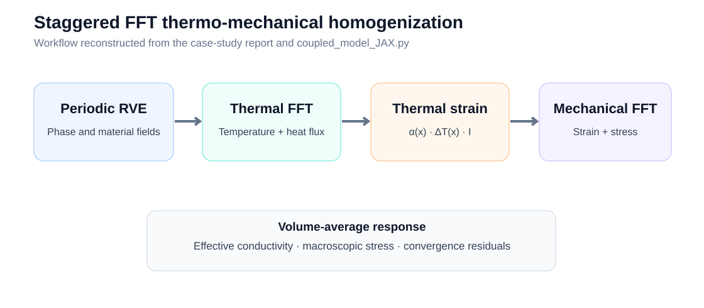
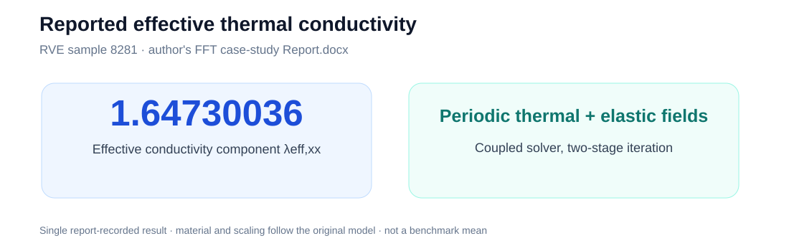

# FFT-Based Thermal and Thermo-Mechanical Homogenization

A JAX-based periodic **Fast Fourier Transform (FFT)** numerical framework for heterogeneous two-dimensional representative volume elements (RVEs). The principal implementation in [coupled_model_JAX.py](coupled_model_JAX.py) solves stationary conduction and subsequently computes a **thermoelastic mechanical response** driven by temperature and prescribed macroscopic strain.

## Physical model

The local thermal flux follows Fourier's law

$$
\mathbf q(\mathbf x)=-\lambda(\mathbf x)\nabla T(\mathbf x).
$$

Periodic FFT iterations recover the fluctuation field around an imposed macroscopic temperature gradient. A second iterative Fourier-space solver computes strains and stresses for a heterogeneous elastic composite, including thermal eigenstrain.

## Implemented features

- Periodic Fourier grids and a two-phase continuous microstructure generated from stored cosine-series coefficients.
- FFT-based thermal conductivity solver with convergence tracking, a prescribed mean gradient, and computed average heat flux.
- Mechanical equilibrium iteration for heterogeneous isotropic elasticity, Lamé parameters, and thermal expansion.
- Selectable radial or square Fourier-mode filtering for numerical experimentation.
- Local field visualization (phase, temperature fluctuation, temperature gradient, total/thermal strain, stress) and convergence curves.

## Repository files

| File | Description |
| --- | --- |
| [coupled_model_JAX.py](coupled_model_JAX.py) | Main coupled thermal/thermoelastic FFT experiment |
| [microstructure_generator.py](microstructure_generator.py) | Construct continuous material fields from input coefficients |
| [Microstructures.ipynb](Microstructures.ipynb) | Supplemental microstructure code snippets |
| `coeff_vec.npy`, `phi0.npy`, `l_data.npy`, `m_data.npy` | Existing microstructure parameters |
| `x_freq_data.npy`, `y_freq_data.npy` | Saved frequency-related arrays |

## Reproducing the computation

Install Python, NumPy, JAX, and Matplotlib. Run from the repository root:

```bash
python coupled_model_JAX.py
```

The script currently sets `N=512`, `sample_id=8281`, a radial spectral mask, and both thermal and mechanical macroscopic loading parameters. These are editable demonstration settings, not universal benchmark defaults. It prints mean gradient, macroscopic heat flux, an effective conductivity component, macroscopic stress, and iteration diagnostics; it also displays the local fields and convergence histories.


## Figures and report-derived result

The figures below are newly rendered summaries of the algorithm and a **recorded value in the FFT thermo-mechanical case-study report**. They are not direct exports of the solver's local-field plots.





The author's separate `Report.docx`, Section 3, records **λeff,xx = 1.647300358806123** for the coupled thermo-mechanical test on microstructure ID 8281, and compares macroscopic quantities and local strain fields against an instructor reference implementation. The report result is a historical experimental output; it has not been re-executed or independently reproduced from the current repository in this documentation update. The working script and report may reflect different experimental iterations or settings, so verify the exact run configuration before treating this value as a reproduced output.

## Results and interpretation

The repository contains **solver implementations and input data**, but does not currently include a recorded, verified execution log or field plots for `coupled_model_JAX.py`. Consequently, no numerical homogenized conductivity or stress value is asserted here. See [results/how_to_record_results.md](results/how_to_record_results.md) for the output quantities and a suggested reproducible reporting format.

The solver is closely related to the numerical reference approach used by the separate [FNO thermal homogenization project](https://github.com/thanhnd034/FNO-homogenization-model). The FNO repository includes its own reduced thermal-only solver and saved prediction/FFT comparison figures.

## Current limitations

This is a research prototype rather than a packaged or independently validated numerical library. Its single scripted run is computationally demanding at 512×512. Adjust grid size and JAX execution environment as necessary. Thermal and mechanical iteration stopping criteria should be checked for the intended materials and load cases.
